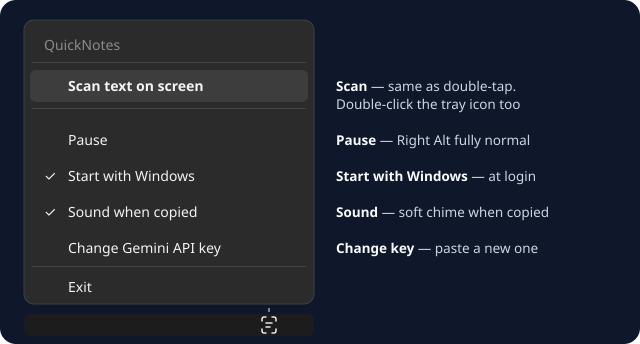
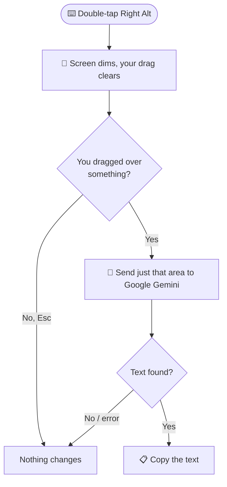

# 📝 QuickNotes


**Copy text from anything on your screen: photos, videos, PDFs, apps. In any language.** Double-tap `Right Alt`, drag over the text, and it's copied. Works great with **Bangla**, English, Hindi and more.

<p align="center">
  
</p>

---

## ⌨️ Controls

| You press | What happens |
|:--|:--|
| `Right Alt` **twice quickly** | 🔲 The screen **dims**. Drag over any text (that area clears) → it's **read and copied** |
| `Esc` or **right-click** | Cancels the scan |
| `Right Alt` **once** | Nothing: Right Alt keeps working normally (AltGr typing too) |

Then just paste (`Ctrl + V`) wherever you want.

### 💬 The little pop-ups

| Pop-up | Meaning |
|:--|:--|
| **Reading text...** | Gemini is reading your selection |
| **Copied** | ✅ Done: the text is on your clipboard (with a soft sound, unless you turned it off) |
| **No text found** | Gemini found no text in your selection |

> 🛡️ Your clipboard is only changed when the text was read successfully. Cancel or an error? **What you had copied stays.**

---

## 🚀 Get started

### ⚡ Easiest: download the .exe (no AutoHotkey needed)

```
 ① Download QuickNotes.exe   →   ② Double-click it   →   ③ Double-tap Right Alt!
```

1. Go to **[Releases](https://github.com/mogdho/QuickNotes/releases/latest)** and download **`QuickNotes.exe`**.
2. **Double-click** it. A small **scan icon** appears in your system tray. 🎉

> 🛡️ **"Windows protected your PC"?** The .exe isn't code-signed (that costs money), so Windows SmartScreen may warn you. Click **More info** → **Run anyway**. Don't trust it? Use the script version below and read the code yourself.

### 🛠️ Or run the script with AutoHotkey

1. **Install [AutoHotkey v2](https://www.autohotkey.com/)** (free).
2. **Download** [`QuickNotes.ahk`](QuickNotes.ahk) from this repository.
3. **Double-click** it.

### 🔑 First launch: add your free Gemini API key (one time, 1 minute)

QuickNotes uses Google Gemini to read text, which is why it understands Bangla and other languages that normal text readers can't. The key is **free**.

The first time you start QuickNotes, a small **setup window** opens by itself:

1. Click **Open AI Studio** and sign in with your Google account.
2. Click **Create API key** → **Copy**. The key appears in the QuickNotes window **by itself**, and the window comes back to the front (or paste it with `Ctrl + V`).
3. Click **Test**. QuickNotes checks the key with Google: **✓ Key works** → the grey **Save** button turns on. A typo? It tells you right away, and Save stays off.
4. Click **Save**. Done!

> 🔒 Your key is **encrypted** with your Windows account, so only you, on this PC, can read it.
>
> 💡 Closed the window by mistake? Just double-tap Right Alt, or use the tray: **Change Gemini API key**.

---

## 🗂️ Tray menu

Right-click the tray icon:

<p align="center">
  
</p>

| Option | What it does |
|:--|:--|
| **Scan text on screen** | Same as double-tapping Right Alt. *Tip: double-click the tray icon to do this.* |
| **Pause** | Right Alt goes back to completely normal until you resume. The icon fades. |
| **Start with Windows** | Starts QuickNotes automatically when you log in. Click again to turn it off. |
| **Sound when copied** | A soft Windows notification sound when the text lands on your clipboard, so you know it's ready without looking. On by default. |
| **Change Gemini API key** | Paste a new key |
| **Exit** | Closes QuickNotes |

> 💡 The icon follows your taskbar: white on a dark taskbar, black on a light one.

---

## 🔐 Privacy

- 📤 **Only the area you select is sent to Google Gemini** to read the text. Nothing else leaves your PC.
- ⚠️ On Google's **free** API tier, Google may use what you send to improve its products. **Don't scan passwords, bank details or other private information.** ([Google's terms](https://ai.google.dev/gemini-api/terms))
- 💾 Nothing is saved: no screenshots, no text files. The text only goes to your clipboard.
- 🔒 Your API key is stored **encrypted** in `%AppData%\QuickNotes`.

---

## 🧠 How it works



- **Built for smoothness:** nothing animates while you wait, and each mouse move only redraws your selection box, paced to your monitor's refresh rate (under 1 ms of work on a 2560×1600 screen). Works on every monitor, at any display scaling.
- **No files:** nothing is saved to disk, and the picture never touches your clipboard.
- **Fast answers:** QuickNotes connects to Google while you're still dragging, keeps that connection open between scans, and asks Gemini to skip "thinking" (reading text doesn't need it). A typical scan takes about 2 seconds.
- Tries `gemini-flash-lite-latest` first, then `gemini-flash-latest`. If Google is briefly overloaded, it waits a moment and tries again.

---

## ❓ Troubleshooting

| Problem | Fix |
|:--|:--|
| Double-tap does nothing | Check the tray icon is there and not faded (paused). Tap a little faster. |
| "Your saved key stopped working" | The setup window opens by itself: paste a new key from AI Studio. |
| "You've hit Google's free limit" | The free tier allows a limited number of scans per minute. Wait a minute. |
| Reads the wrong text | Drag a tighter box around just the text you want. |
| The dim scan screen closed by itself | It closes if you switch windows (Alt+Tab) or leave it open for 2 minutes. Just double-tap again. |

---

## 🗑️ Uninstall

1. Right-click the tray icon → **untick Start with Windows** *(removes its startup task)*.
2. Right-click the tray icon → **Exit**.
3. Delete `QuickNotes.exe` / `.ahk`, and the `%AppData%\QuickNotes` folder (your encrypted key and settings).

> ⚠️ **Already deleted it?** The startup task is left behind. Press `Win + R` → `taskschd.msc` → right-click **QuickNotes (AutoHotkey)** → **Delete**.

---

### 🔗 Download / Source
- 📂 **Repository:** [github.com/mogdho/QuickNotes](https://github.com/mogdho/QuickNotes)

### 👨‍💻 Author
**Mogdho Paul** · [github.com/mogdho](https://github.com/mogdho)
